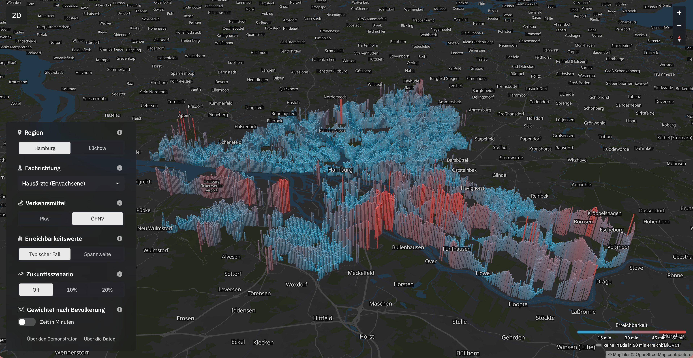

# MobiViz – MobiDoc Demonstrator

**Live demo:** https://viulab-hh.github.io/mobiviz/



The demonstrator shows the modelled accessibility of doctors' practices as travel times in minutes. For various medical specialties, it shows accessibility in **Hamburg** and **Lüchow-Dannenberg**, along with the possible variation of these values. The map can switch between a flat 2D view and an extruded 3D view. In its current form, the app is available in German only.

> The demonstrator does **not** provide patients with individual information on specific travel times. It is meant as one criterion for assessing regional differences in healthcare provision.

## About the project

The demonstrator and its underlying data were developed in the project [MobiDoc](https://www.bmv.de/SharedDocs/DE/Artikel/mFUND/Projekte/mobidoc.html) (Advanced spatio-temporal modelling and simulation of the accessibility of medical facilities), which focused on an extended analysis of the accessibility of medical care. The aim of the project was to better estimate and visualize spatial and temporal differences in the accessibility of doctors' practices. To this end, travel times were modelled, uncertainties in the underlying data were taken into account, and user-oriented visualizations were developed and evaluated.

The visualization was developed at the [viu:lab](https://viulab.haw-hamburg.de) (HAW Hamburg). MobiDoc was funded by the mFUND programme of the German Federal Ministry for Digital and Transport (BMV).

## Features

- **2D ↔ 3D transition:** animated switch between a flat map and extruded columns (MapLibre `fill-extrusion`), via button or by tilting the map
- **Region:** Hamburg or Lüchow
- **Specialty:** general practitioners (adults / children), surgery, dermatology, ophthalmology, ENT, internal medicine, radiology, neurology/psychiatry, urology and more
- **Uncertainty:** show mean values only, or include minimum/maximum ranges
- **Future scenarios:** accessibility with 10 % or 20 % fewer specialist physicians
- **Population weighting:** factor in the number of residents per cell

## Data

Accessibility values are modelled travel times to doctors' locations. They are based on:

- a manually compiled dataset of doctors' locations
- the OpenStreetMap road network
- GTFS public transport data (DELFI)
- 100 m grid cells from the 2022 German census (incl. population counts) as origins

Calculations were done in Python with [r5py](https://r5py.readthedocs.io/) by the [g2lab, HafenCity Universität Hamburg](http://www.geomatik-hamburg.de/g2lab/).

The data are stored as GeoJSON point files (one file per specialty and region):

```
data/
├── 20261110-hamburg/   # Hamburg, one <specialty>.geojson per specialty
└── 20261110-luechow/   # Lüchow-Dannenberg
```

Each feature is the centroid of a 100 m census grid cell. Attribute names follow the pattern `<mode>_<measure>_<share of physicians>`:
 
- `<mode>`: `car` (car) or `transit` (public transport)
- `<share of physicians>`: `100pctDocs` (status quo), `090pctDocs` / `080pctDocs` (scenarios with 10 % / 20 % fewer physicians)


| Attribute (per mode) | Meaning |
|---|---|
| `<mode>_tNom_100pctDocs` | Mean travel time in minutes (status quo) |
| `<mode>_tMin_100pctDocs`, `<mode>_tMax_100pctDocs` | Lower / upper bound of the travel time |
| `<mode>_tNom_090pctDocs`, `<mode>_tNom_080pctDocs` | Mean travel time in the 90 % / 80 % scenarios |
| `<mode>_EwM_22_Nom/Min/Max_100pctDocs` | Person-minutes (travel time × residents of the cell), population 2022 (census) |
| `<mode>_EwM_40_Nom_090pctDocs`, `<mode>_EwM_40_Nom_080pctDocs` | Person-minutes in the 90 % / 80 % scenarios, projected population 2040 |

Example: `transit_tMax_100pctDocs` is the upper bound of the public-transport travel time in the status quo.
 
Cells without a practice within 60 minutes are treated as not reachable in the app.
 
⚠️ The `data/` folder is about 430 MB in total (Hamburg ≈ 370 MB, Lüchow-Dannenberg ≈ 60 MB).

## Running locally

The app is a single static page (`index.html`) without a build step. It has to be served over HTTP, because the GeoJSON files are loaded via `fetch`:

```bash
git clone https://github.com/viulab-hh/mobiviz.git
cd mobiviz
python3 -m http.server 8000
# open http://localhost:8000
```

### MapTiler API key

The basemap (`basic-v2-dark`) is loaded from [MapTiler](https://www.maptiler.com/). The key is defined in `tokens.js`:

```js
const MAPTILER_KEY = 'YOUR_MAPTILER_API_KEY';
```

The key in this repository is restricted to the allowed origins of the project (`viulab-hh.github.io`), so it will **not** work on `localhost`. For local development, create your own free key at [cloud.maptiler.com](https://cloud.maptiler.com/account/keys/), add `localhost:<port>` under *Allowed HTTP origins*, and put it into `tokens.js` (do not commit it).

## Project structure

```
index.html   # the complete application (HTML, CSS, JS)
tokens.js    # MapTiler API key
data/        # travel-time data (GeoJSON)
lib/         # vendored libraries (anime.js)
archive/     # earlier versions of the prototype
```

## Tech stack

- [MapLibre GL JS](https://maplibre.org/) 2.4.0
- [MapTiler](https://www.maptiler.com/) basemap
- [anime.js](https://animejs.com/)
- IBM Plex Sans, Font Awesome

## Credits

- **Visualization & development:** viu:lab, HAW Hamburg
- **Accessibility modelling:** g2lab, HafenCity Universität Hamburg
- **Funding:** mFUND, Federal Ministry for Digital and Transport (BMV)
- **Map data:** © [MapTiler](https://www.maptiler.com/copyright/) © [OpenStreetMap contributors](https://www.openstreetmap.org/copyright)

## License

**Code** (`index.html`, `tokens.js`) is released under the [MIT License](LICENSE).
© 2026 viu:lab, HAW Hamburg

**Data** (`data/`) is released under [CC BY 4.0](https://creativecommons.org/licenses/by/4.0/).
© g2lab, HafenCity Universität Hamburg. The data are derived from:

- © [OpenStreetMap contributors](https://www.openstreetmap.org/copyright), available under the [ODbL](https://opendatacommons.org/licenses/odbl/)
- Zensus 2022, © Statistische Ämter des Bundes und der Länder, [dl-de/by-2-0](https://www.govdata.de/dl-de/by-2-0)
- GTFS timetable data © [DELFI e.V.](https://www.delfi.de/)

**Third-party libraries** keep their own licenses (e.g. anime.js: MIT, see `lib/`).
